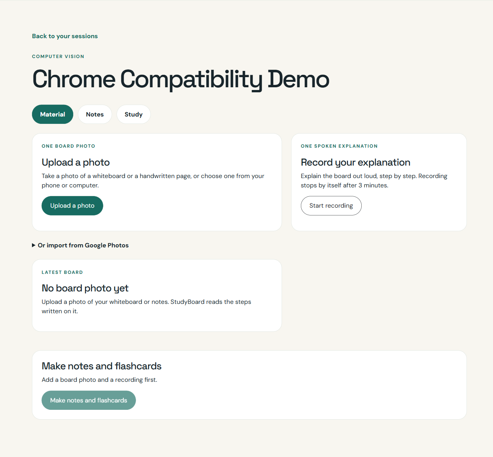
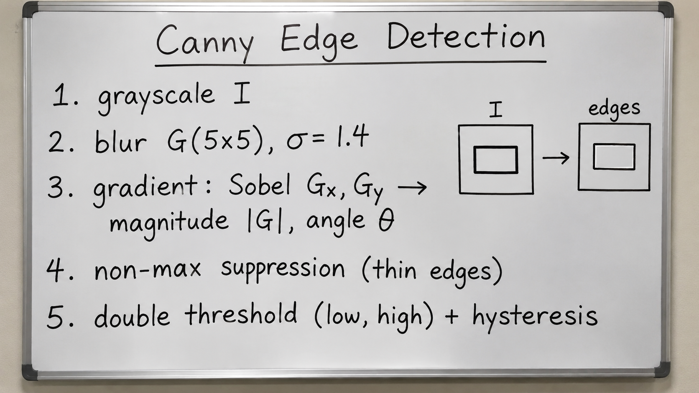
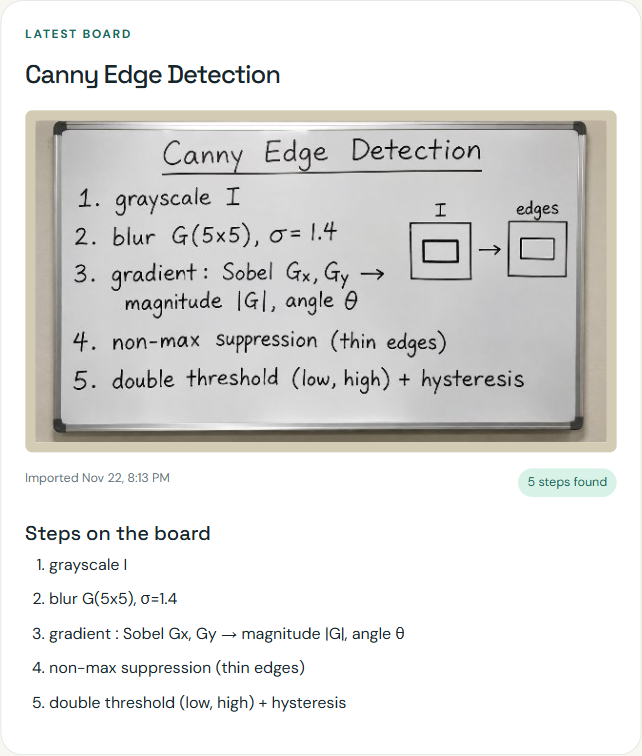
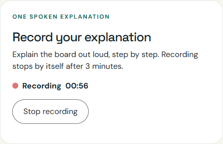
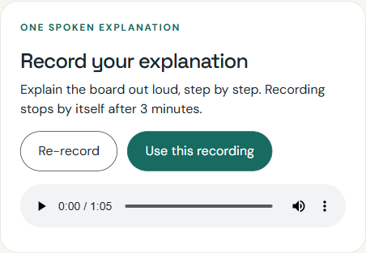
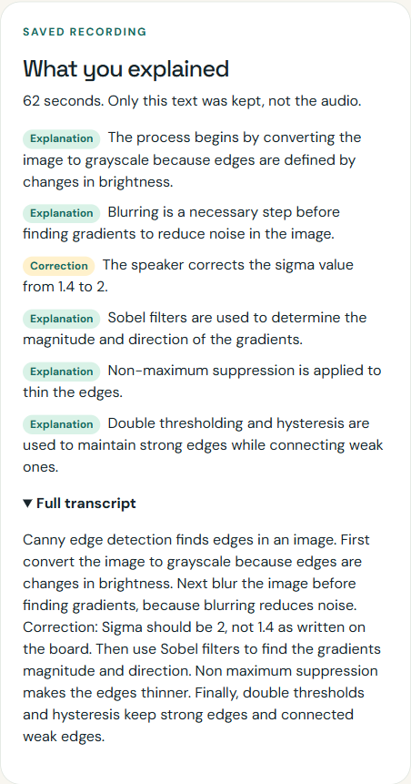
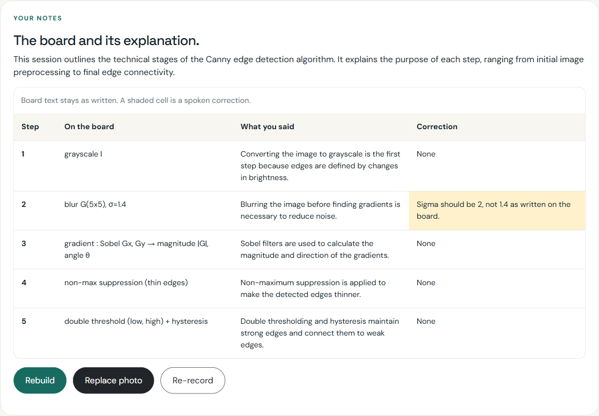
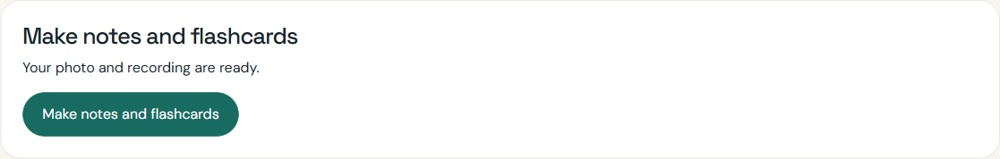
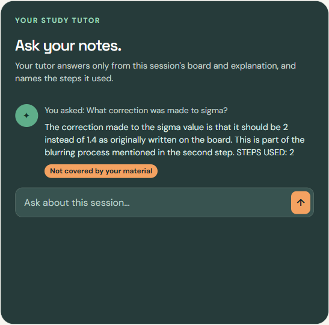
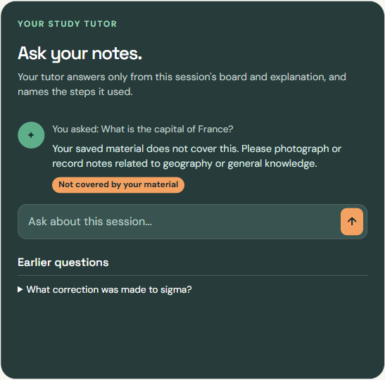

# Application Demonstration

This page is a draft walkthrough of one StudyBoard session, from sign-in and
source material to notes, flashcards, and the study tutor. It describes the
current application and includes observed Chrome evidence. Some evidence and
browser outcomes remain to be completed.

> Chrome evidence is shown below; the final cross-browser pass remains incomplete.

## 1. Sign In

1. Open **Sign in** from the navigation. Use **Continue with Google**, or sign in
   with an existing email and password. The page also offers account creation
   and password reset.
2. After successful authentication, the application opens the workspace at
   `/app/`. A user who is already signed in can choose **Go to your sessions**.

## 2. Create a Study Session

1. On the dashboard, enter a **Title** and a free-text **Course**, then choose
   **New study session**. Course suggestions are available, and a blank course
   becomes `General`.
2. The new session opens immediately in its workspace. Use **Back to your
   sessions** to return to the dashboard and reopen its entry when needed.

## 3. Add One Board Photo

Open the session's **Material** tab. Choose one whiteboard or handwritten-page
photo by either route below.

### Demonstration Material

The Chrome demonstration used the following Canny edge-detection board as the session material. Step 2 intentionally contains `σ = 1.4` so the spoken explanation can demonstrate a correction to `2`.

### Upload from Device

Choose **Upload a photo** and select an image from the phone or computer. The
browser makes JPEG copies for the upload; after processing, the board preview
shows the saved photo and recognized steps.

### Import from Google Photos

This option is shown for Google sign-ins. Google Photos access is requested
separately from account sign-in.

1. Expand **Or import from Google Photos** and select **Choose a photo in Google
   Photos**. Allow the requested Photos permission to start the Picker session.
2. Select **Open Google Photos**, choose one board photo in the Picker, and
   return to StudyBoard.
3. Select **Import my picked photo** and wait for processing and the board
   preview. The Picker interaction still needs browser verification.

> **Screenshot TODO — Google Photos import:** Capture the import controls and
> selected-photo/Picker state without exposing unrelated photos, then the
> processed board preview and its numbered steps.

## 4. Record the Spoken Explanation

1. In Material, choose **Start recording** and allow microphone access. The
   panel shows elapsed time and stops automatically after three minutes.
2. Choose **Stop recording** to stop sooner. Play back the take, or choose
   **Re-record** to replace it. Recording is made with the microphone at runtime;
   the panel does not offer an audio-file upload alternative.
3. Choose **Use this recording** to process and save it. The saved material shows
   a transcript and spoken points tagged `explanation`, `correction`, or
   `emphasis`.

## 5. Demonstrate a Spoken Correction

For the final browser demonstration, use a board that says **`σ = 1.4`**. In the
spoken explanation, explicitly say that sigma should be **2**, not **1.4** as
written. After building, check the Notes tab: the original board value should
remain visible, and the spoken correction should appear separately rather than
silently replacing it. The observed Notes result is shown below.

## 6. Build Notes and Flashcards

With processed photo and audio present, choose **Make notes and flashcards** on
Material. The server makes notes and then flashcards. The build status is shown
while it runs; a completed result opens the **Notes** tab. The server also
requires readable board steps and a nonempty transcript.

## 7. Review Generated Notes

The **Notes** tab shows a summary and a table with **Step**, **On the board**,
**What you said**, and **Correction**. Board text remains as written; a spoken
correction is displayed in a shaded cell. A step without a saved explanation
shows **Not explained in the recording.**

## 8. Study with Flashcards

Open **Study** to review the saved generated cards. Click a card to flip between
question and answer; the card displays its source **Step**. Use **Previous** and
**Next card**, mark it **Got it** or **Still learning**, or select **Only cards I
don't know yet** to load the backend's unknown-card view. **Delete card** asks
for confirmation before deletion. An empty deck shows an explanatory message.

## 9. Ask the Study Tutor

In **Study**, type a question under **Ask your notes.** and send it. The tutor is
intended to answer from the current session's saved material. It displays the
answer and either source steps or a not-covered indicator. Earlier questions are
available under **Earlier questions**; the current history is limited to the
latest 20.

### Covered Question

For the sigma demonstration, ask: **“What correction was made to sigma?”** The
final evidence should show the submitted question, the actual generated answer,
and **Steps used:** with the relevant board step. Check the answer against the
saved notes; do not assume the model's result in advance.

The answer correctly cited step 2 in its text, but the interface also displayed
**Not covered by your material**. This inconsistency remains unresolved.

> **Screenshot TODO — Covered tutor question:** Capture the sigma question, the
> tutor's actual answer, and the visible **Steps used:** line with its step number.

### Uncovered Question

Ask a question deliberately unrelated to the selected board, such as **“What is
the capital of France?”**, provided that fact is absent from the session. Check
that the response reflects the saved material's limits and displays **Not covered
by your material**. The exact generated answer is not prescribed here.

## 10. Replace Material and Rebuild

### Replace Photo

From Notes, select **Replace photo** to return to Material. Upload or import a
replacement board photo in the same session. When notes already exist, saving
changed material marks them as needing a rebuild.

### Re-record

Select **Re-record** on Notes to return to Material, then make and save a new
microphone recording with **Use this recording**. This replaces the session's
saved processed recording; it does not create another session.

### Rebuild

Return to Notes and choose **Rebuild** to generate notes and cards from the
currently saved material. A successful rebuild replaces the generated card set;
the new cards start as not known, so earlier review marks do not carry over.
The Chrome pass observed a successful rebuild after replacing the recording and after re-uploading the same photo.

The photo was also re-uploaded using the same supplied image and a subsequent rebuild succeeded. A different photo was not tested.

## 11. Error and Retry Behavior

Use safe, reversible examples during the final pass:

1. **Microphone permission denied:** Start recording and deny access. The source
   displays **Microphone access is blocked. Allow the microphone for this site in
   your browser settings, then try again.** The status includes **Try again**;
   allow access before retrying.
2. **Photos permission or Picker not finished:** If Photos permission is denied,
   the panel displays the authorization error and **Try again**. If import is
   attempted before selection is finished, it displays the server error and
   retains **Open Google Photos** so the user can finish selection, then retry.
3. **Build failure:** If a build fails naturally, the Material or Notes status
   displays the returned message and **Try again**. Do not damage saved data or
   change cloud configuration merely to force an error.

The scenarios above are source-based expectations; the observed Chrome evidence is shown below.

During the Chrome pass, Google Photos authorization showed 403 `access_denied`
because the app was limited to approved testers. StudyBoard then displayed the
window-closed message above. The Try again control reopened the Google authorization window; the approved-tester restriction still blocked import. Microphone denial also produced a clear message and retry control. After permission was restored and the page reloaded, a new recording started; the microphone retry button itself was not exercised.

> **Screenshot TODO — Retry outcome:** Capture the subsequent outcome after a
> safe retry. Hide account details and unrelated personal material.

## 12. End-to-End Demonstration Checklist

- [ ] Sign in.
- [ ] Create a session with title and course.
- [ ] Import a board photo, including the Google Photos path when available.
- [ ] Record and save an explanation.
- [ ] Build notes and flashcards.
- [ ] Show `σ = 1.4` on the board and a separate correction to `2`.
- [ ] Review notes.
- [ ] Review flashcards and their source steps.
- [ ] Ask a covered tutor question and show source steps.
- [ ] Ask an uncovered question and show the not-covered indicator.
- [ ] Replace the photo.
- [ ] Re-record the explanation.
- [ ] Rebuild and inspect reset review state.
- [ ] Capture a representative error.
- [ ] Demonstrate its retry behavior.

Final verification fields, to be completed after the browser pass:

- Chrome version: 157.0.8103.79
- Chrome test date: 2026-11-22
- Safari version:
- Safari test date:
- Deployed application URL: https://studyboard-389363739519.us-central1.run.app/
- Final screenshot pass completed:
