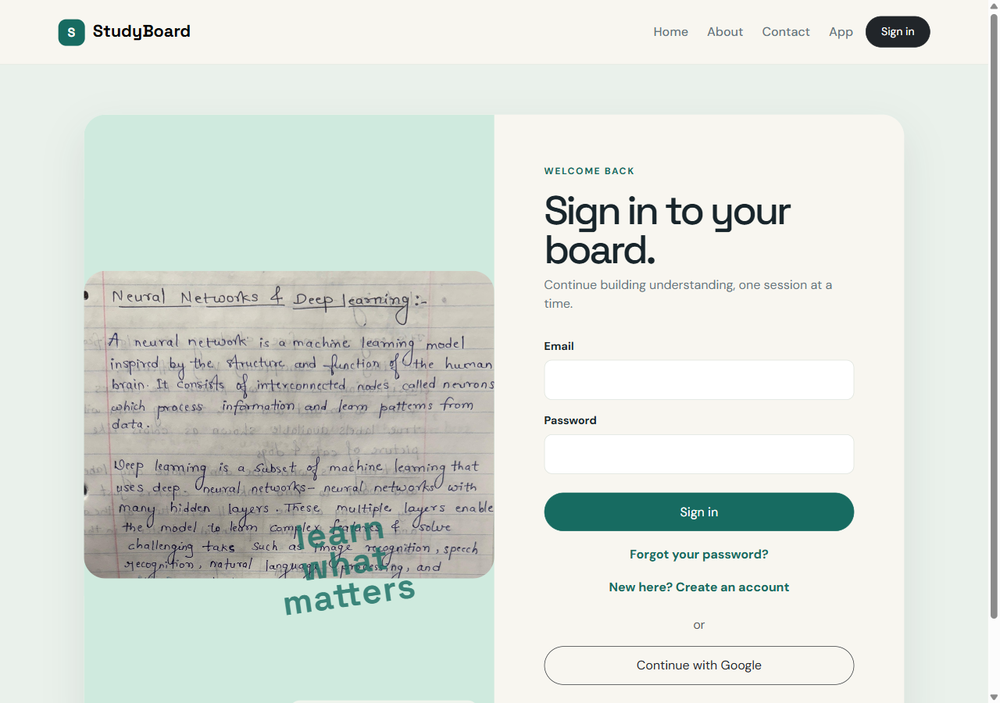
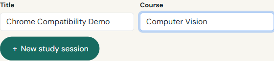
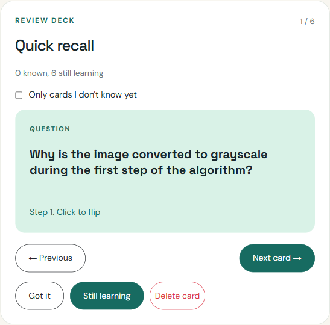
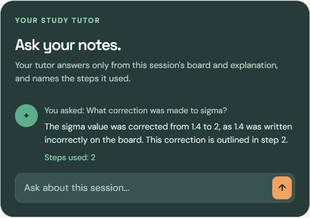
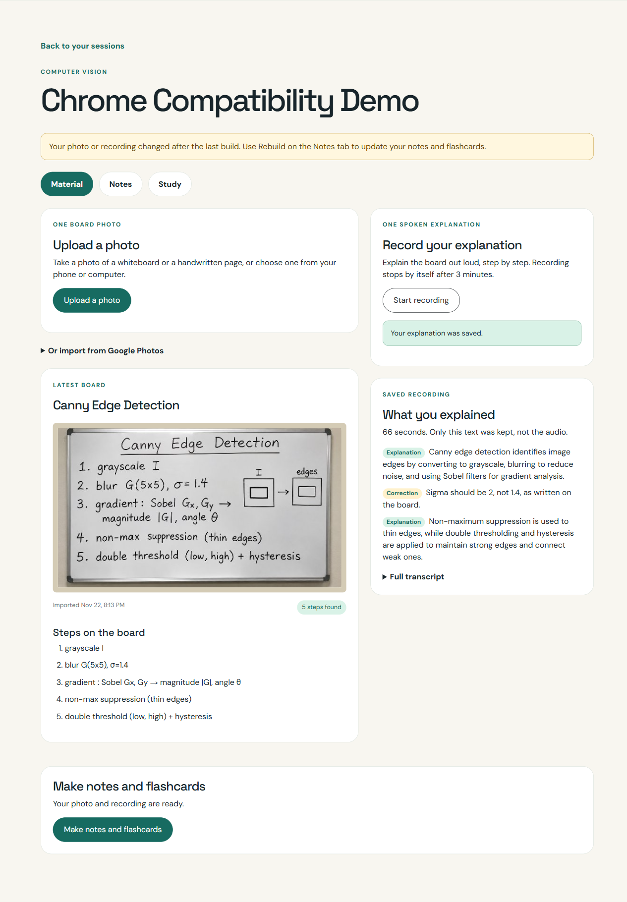
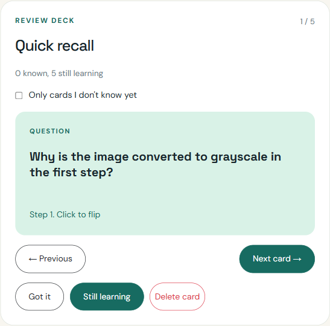
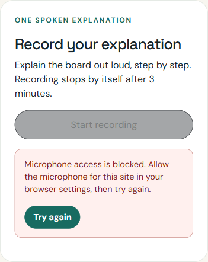
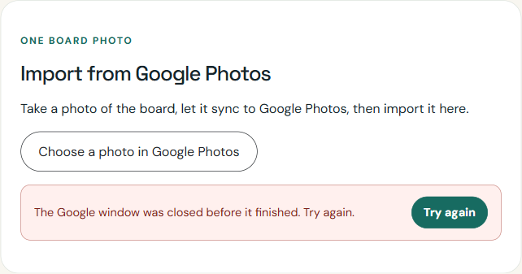

# Application Demonstration

## 1. Application overview

StudyBoard turns a whiteboard photograph and a spoken explanation into study
material. A student creates a session, adds a board photo, records an
explanation, generates notes and flashcards, and asks a tutor questions grounded
in that session's saved material.

This walkthrough uses a Canny edge-detection board with five steps. The
screenshots show real demonstration and compatibility-test sessions; generated
wording and card counts may vary between builds.

## 2. Authentication and dashboard

1. Open **Sign in** and use an existing email/password account or **Continue
   with Google**. Google sign-in opens a separate authentication window.
2. On the dashboard, enter a **Title** and **Course**, then select **New study
   session**. The new session opens with **Material**, **Notes**, and **Study**
   tabs. The dashboard can be used to reopen a saved session.

*The sign-in page, with no credentials entered.*

*Creating the demonstration session.*

## 3. Import study material

The board below is the source image used in the demonstration. Its second step
reads **σ = 1.4**; the recording will provide a different value as a spoken
correction.

*The original five-step board.*

### Upload from a device

1. In **Material**, select **Upload a photo** and choose the board image.
2. Wait for processing. The preview shows the board and the recognized steps.

*The processed device upload, including the original value in step 2.*

### Import from Google Photos

For a Google sign-in, expand **Or import from Google Photos**, select **Choose a
photo in Google Photos**, and authorize Photos access when prompted. Open the
Picker, choose the image, return to StudyBoard, and select **Import my picked
photo**. Wait for the processed board preview.

The Edge and Safari compatibility reports record successful Google Photos
imports. No screenshot of the Picker is included; the image above documents a
**device upload**. During
the earlier Chrome pass, Google Photos authorization was blocked for the test
account; its cancellation and retry behavior is described below.

## 4. Record a spoken explanation

1. Select **Start recording** and allow microphone access. The recorder shows an
   elapsed timer and is configured to stop after three minutes.
2. Explain the board aloud. For this example, say: “Sigma should be 2, not 1.4
   as written on the board.”
3. Select **Stop recording**. Play the take back if desired, or choose
   **Re-record** to make a replacement. Select **Use this recording** to process
   and save it.
4. The saved material displays a transcript and spoken points such as
   **Explanation** and **Correction**; emphasis can also be tagged when present.

*The active recording indicator and timer.*

*The completed take before it is submitted. Audible playback was separately
confirmed in the Edge and Safari tests.*

*The processed explanation, including a correction point.*

## 5. Generate notes and flashcards

When the board and recording are ready, select **Make notes and flashcards**.
The interface shows build progress and opens the generated **Notes** view when
the build succeeds. The **Study** tab contains the resulting flashcards and tutor.

*Both sources are ready for generation.*

## 6. Demonstrate the spoken correction

The Notes view combines the recognized board text and the explanation by step.
Its table has **On the board**, **What you said**, and **Correction** columns.

In step 2, the board text remains **σ = 1.4**, while the shaded correction says
sigma should be **2**. Keeping both values visible shows the written source and
the later spoken correction together.

*The original board value and separate spoken correction in step 2.*

## 7. Review flashcards

Open **Study**. Select a card to flip between its question and answer; the card
also identifies its source step. Use **Previous** and **Next card** to navigate,
mark a card **Got it** or **Still learning**, and select **Only cards I don't
know yet** to focus on unknown cards.

*A question card with navigation, review marks, and the filter.*

## 8. Study tutor

In **Ask your notes**, enter a question and submit it. The following examples
show a question covered by the board and one outside the saved material.

### Covered question

Ask **“What correction was made to sigma?”** In the later Edge test, the tutor
answered that sigma was corrected from **1.4 to 2** and displayed **Steps
used: 2**.

*The covered question and its source step, observed in Edge.*

### Uncovered question

Ask **“What is the capital of France?”** The tutor identifies that the saved
Canny material does not cover the question.

*The unrelated question is marked as not covered by the material.*

An earlier Chrome observation produced a correct sigma answer but also displayed
the **Not covered by your material** label. Later Edge and Safari tests showed
the covered question with step 2 and without that inconsistent label. Those
later results do not establish a Chrome retest; the earlier observation remains
in the Chrome report.

## 9. Replace material, re-record and rebuild

1. From **Notes**, select **Replace photo** and upload or import a board in the
   same session. Alternatively, choose **Re-record**, capture a new explanation,
   and select **Use this recording**.
2. After changed material is saved, StudyBoard indicates that existing notes and
   cards need a rebuild. Select **Rebuild** on Notes.
3. Review the regenerated notes and cards. The Chrome and Edge tests observed
   that rebuilt cards started with no cards marked known.

*The notice appears after the replacement recording is saved.*

*The rebuilt deck's review state. The device-photo replacement test re-uploaded
the same board; it did not compare different board content.*

## 10. Error and retry

In the Edge test, blocking microphone permission produced a clear message and a
**Try again** control. After permission was restored and the page reloaded, a
fresh recording started. The test did not exercise that original retry button
after the reload.

*The microphone permission error, with instructions to allow access.*

A separate Google Photos cancellation check displayed a window-closed message.
In Edge, **Try again** reopened authorization, and a later user-performed retry
successfully imported the photo. The Chrome attempt remained blocked for its
test account.

*The window-closed message observed during the Chrome pass.*

## 11. Demonstration results and evidence

The recorded workflow shows a student moving from a photographed board and
spoken explanation to generated notes, flashcards, and grounded tutor responses.
It also demonstrates a separate spoken correction, replacement and rebuild, and
representative error and recovery behavior.

Browser observations are documented in the
[Chrome compatibility report](https://github.com/dishd123/StudyBoard/blob/main/docs/chrome-compatibility.md),
[Edge compatibility report](https://github.com/dishd123/StudyBoard/blob/main/docs/edge-compatibility.md),
and [Safari compatibility report](https://github.com/dishd123/StudyBoard/blob/main/docs/safari-compatibility.md).
The Chrome report retains the covered-tutor inconsistency and its blocked
Photos import; the later Edge and Safari reports record their own successful
checks. The Safari report also notes that its exact recording MIME type was not
observed. The reports distinguish screenshots from tester-confirmed actions,
including Google Photos import and audible playback.
