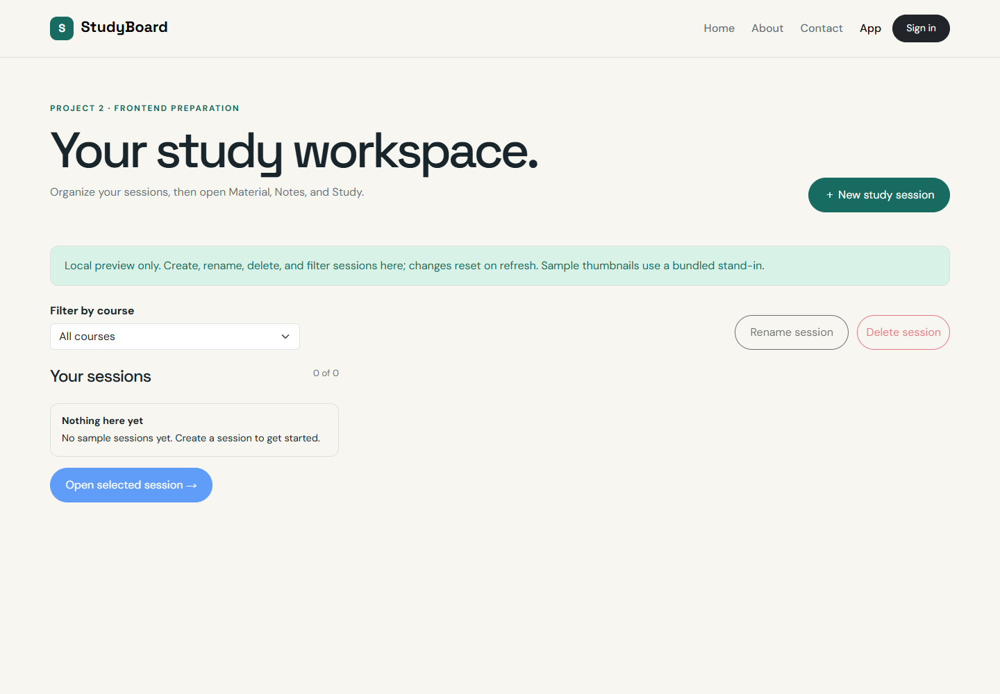
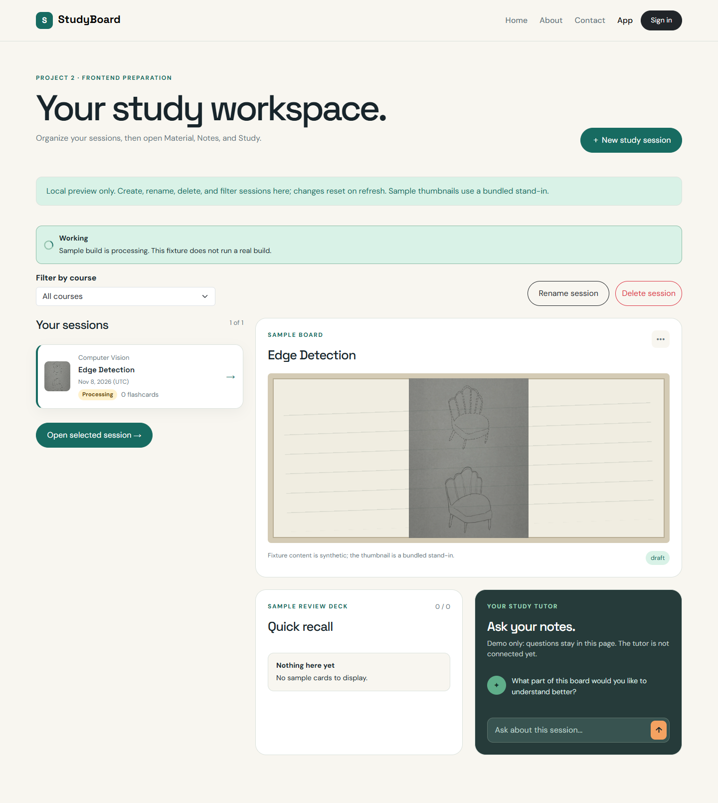
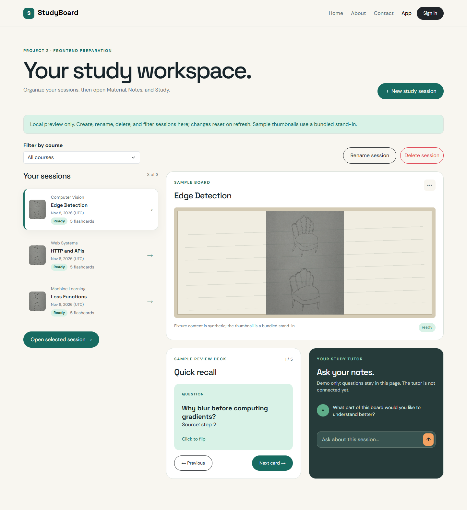
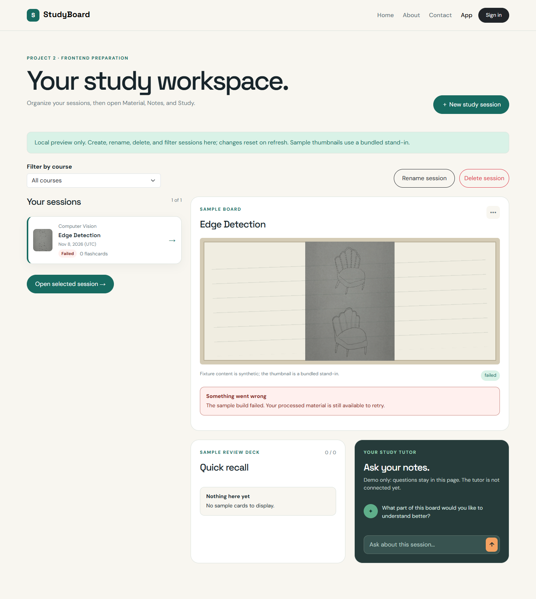

# Dashboard and session shell — issue #6

Owner: Huda Joad. Related issue: [#6](https://github.com/dishd123/StudyBoard/issues/6).
Scope: Phase 0 frontend preparation with fixture data and local React state.

## Files and boundaries

| File | Responsibility |
| --- | --- |
| `src/app/App.jsx` | Initializes a fresh workspace fixture; owns local sessions/cards/questions, selection, course filter, sorting, and session mutations. |
| `src/pages/Dashboard.jsx` | Composes the list, filter, selected preview, action controls, feedback, and dialog. |
| `src/components/SessionList.jsx` | Renders visible sessions, visible/total count, selection, processing flags, and empty/filter-empty feedback. |
| `src/components/SessionCard.jsx` | Displays thumbnail or placeholder, title, course, UTC creation date, readable status badge, and card count. |
| `src/components/SessionDialog.jsx` | New/Rename validation and Delete confirmation with native modal keyboard/focus behavior. |
| `css/site.css` | Responsive dashboard controls, badges, thumbnails, compact preview, long-title wrapping, and dialog styles. |

Huda owns all implementation in this issue. The shared contracts/fixtures remain
from #3 and feedback uses #5's `StatusMessage`. This does not connect Firebase,
Firestore, or the #4 API client. Real sessions/cards routes remain #35; dashboard
API integration remains #36.

## Local behavior

### Listing and filtering

Sessions are sorted newest first by `createdAt`, not by rename time. Dates are
shown in UTC to match the model's ISO serialization. The course filter is
generated from existing free-text course names and matches the selected name
exactly. There is no separate course collection or course-management screen.

Changing the filter selects the first visible session. Selection/open controls
never point to a hidden session. Back from the session workspace retains the
current selection and filter. The list shows visible/total counts.

Processing is a temporary fixture operation associated with the initial
processing session. Its card shows Processing while its stored status remains
draft. Selecting or creating a different session does not inherit that operation.
Ready/failed/draft badges use stored session status. No simulated processing
request is started or completed by these controls.

### New session

New opens a labelled native dialog with Session title and Course name inputs.
Both require non-whitespace text. Existing course names are suggestions, but any
free-text course name is accepted. Submitted values are trimmed. Blank values
show a validation alert and focus the first invalid field.

Creation assigns a fresh local ID and timestamps using the #3 session factory.
The draft has no photo/audio, summary/notes, cards, or questions. The course
filter resets to All courses, and the new session is selected at the top. It can
open the existing Material/Notes/Study shell. Duplicate titles are allowed;
identity comes from the session ID.

### Rename

Rename opens with the selected title. It validates/cleans the new title and
updates `updatedAt`. It leaves the ID, course, material, notes, cards, and
questions intact. The creation-date ordering is unchanged. The imported photo
result's own title is not rewritten when the session is renamed.

### Delete

Delete opens a confirmation naming the selected session and its related sample
cards/history. Cancel receives initial focus, and Escape dismisses the dialog
without changing data. Confirm removes the local session plus its card/question
map entries. This is not Firestore deletion.

After deletion the first visible remaining session is selected. If no remaining
session belongs to the active course, the filter resets to All courses. When
the final session is removed, Rename/Delete/Open are disabled and New remains
available. A new session can recover an empty workspace.

### Feedback, persistence, and accessibility

Actions display success feedback explicitly describing the local preview.
Changes survive opening a session and returning to the dashboard, but refresh
recreates the chosen fixture and resets local edits. No localStorage, credentials,
database connection, or network request is introduced.

Dialogs have linked headings/descriptions, labelled inputs, associated validation
messages, invalid-field state, native focus containment, Escape cancellation,
and explicit focus restoration when the invoking control remains available.
If deletion disables that control, focus returns to New study session. Session
selection uses native buttons with `aria-pressed`; lists use list markup and
dates use `<time>`. Status badges include text, not just color. Long text wraps
in both session cards and preview headings. The dashboard image is a compact
preview; the Material tab retains the separate board view.

## Manual review

Run `npm run dev` and open `http://localhost:5173/app/`.

1. Filter by Web Systems, open its session, and return.
2. Create a session with a title and a new free-text course name.
3. Rename it; verify blank/whitespace input is rejected.
4. Cancel a deletion, then confirm one.
5. Delete the remaining samples and verify empty-state controls.
6. Create from empty, then refresh to see the fixture restored.
7. Revisit `?fixture=processing`, `?fixture=ready`, and `?fixture=failed`.

The development fixture selector remains from #3. The production preview uses
the default ready fixture until real API integration is implemented. This issue
does not implement photo import, recording, note generation, or tutor answers.

## Required screenshot evidence

Captured from the actual local Vite preview on November 9, 2026 using headless
Chrome at a 1440 × 1000 viewport (full-page images). These are frontend fixture
states, not live processing or historical issue-board screenshots.

### Empty

### Processing

### Ready

### Failed

## Acceptance mapping

| Issue #6 criterion | Evidence |
| --- | --- |
| Dashboard uses fixture data | Workspace initialization and local-state mutations in App. |
| Empty dashboard state | Empty fixture and deletion of the final session; New stays available. |
| Title/course/date/status/card count | SessionCard, plus thumbnail/placeholder and processing UI state. |
| New/Rename/Delete/filter controls | Validated dialogs, confirmation, dynamic course filter, selected-session callbacks. |
| No Firebase/backend requirement | Local state only; future API integration remains #36. |
| Required screenshots | Four actual fixture screenshots embedded above. |

## Verification results

Codex performed these checks on November 9, 2026 with Linux Node `v22.23.2`
and headless Chrome through Playwright. A temporary Vite server used port `4175`
without taking over Huda's normal server. No dependency/lockfile changes were
needed.

| Check | Result |
| --- | --- |
| Production build | Passed for both React entries and copied static pages. |
| Required fixture states | Empty/processing/ready/failed rendered and were captured in the four screenshots above. |
| Session fields | Title, course, UTC date, status, card count, and thumbnail rendered. |
| Filter/select/open/back | Passed; selected session belongs to the visible course and the filter survives returning from the workspace. |
| Create | Passed blank/whitespace validation, associated error/focus, trimming, free-text course, newest-first order, and opening a draft with no cards. |
| Rename | Passed validation/cancel and trimmed update; course and original deck retained. |
| Delete | Passed initial Cancel focus, Escape cancellation, explicit confirmation, active-course cleanup, and preservation of other session decks. |
| Duplicate titles | Passed; separate generated IDs keep same-title sessions distinct. |
| Final deletion/empty recovery | Passed; Rename/Delete/Open disabled, New enabled and focused, and a session can be created from empty. |
| Refresh | Passed; restores the fixture and discards local mutations. |
| Processing scope | Passed; a newly created draft does not inherit the original fixture's processing operation. |
| Mobile/long text | Passed at 390 × 844 after correcting preview-heading wrapping; no page/dialog horizontal overflow. |
| Modal focus restoration | Passed; Escape restores the invoking control when available. |
| Existing pages | Home/About/Contact/Login route and navigation rendering checks passed. |
| Network/runtime | No backend API calls or browser runtime errors observed. |
| Whitespace | Passed. |

The browser checks were one-off implementation verification. Dedicated
persisted frontend test files remain under issue #12; full cross-browser and
assistive-technology checks remain later QA work. These results cover frontend
mock behavior only, not Firestore persistence or cloud deployment. Issue #6 is
ready for review in its own PR with `Closes #6`.
