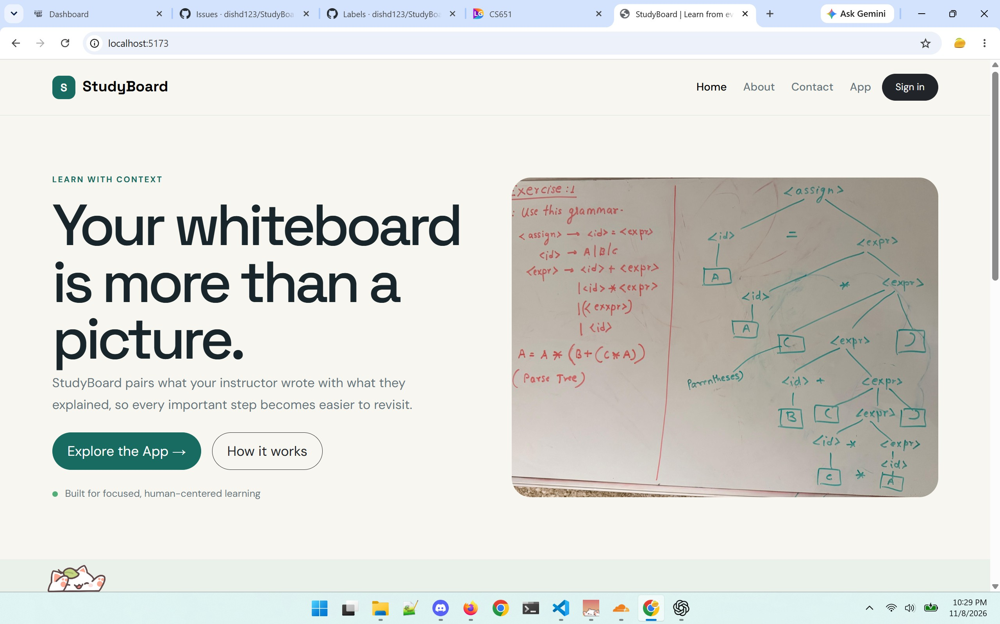
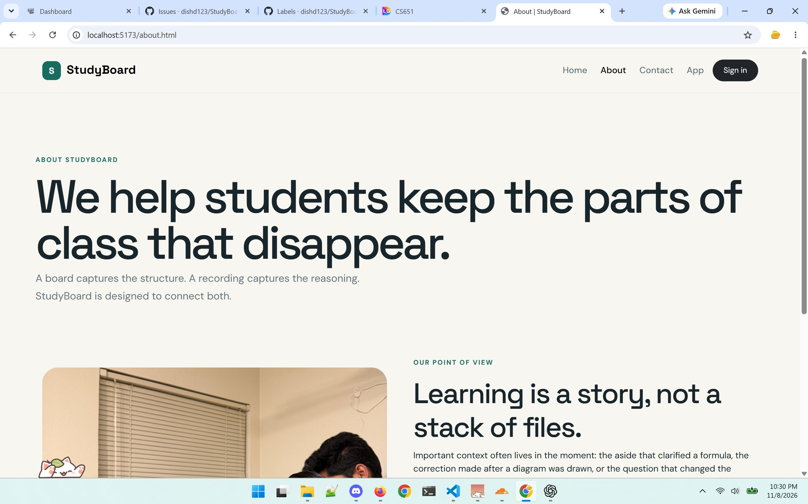
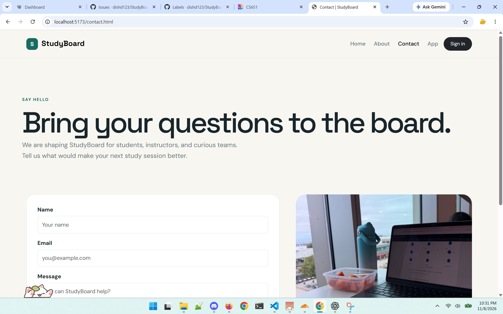
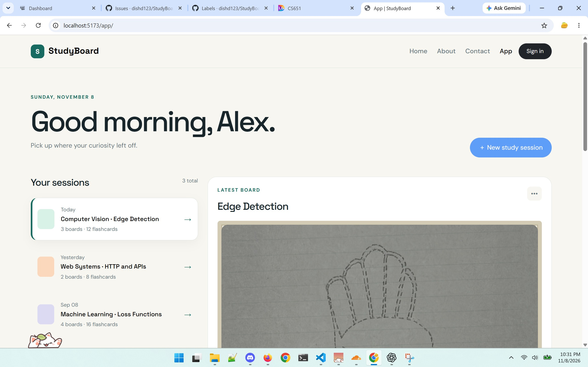
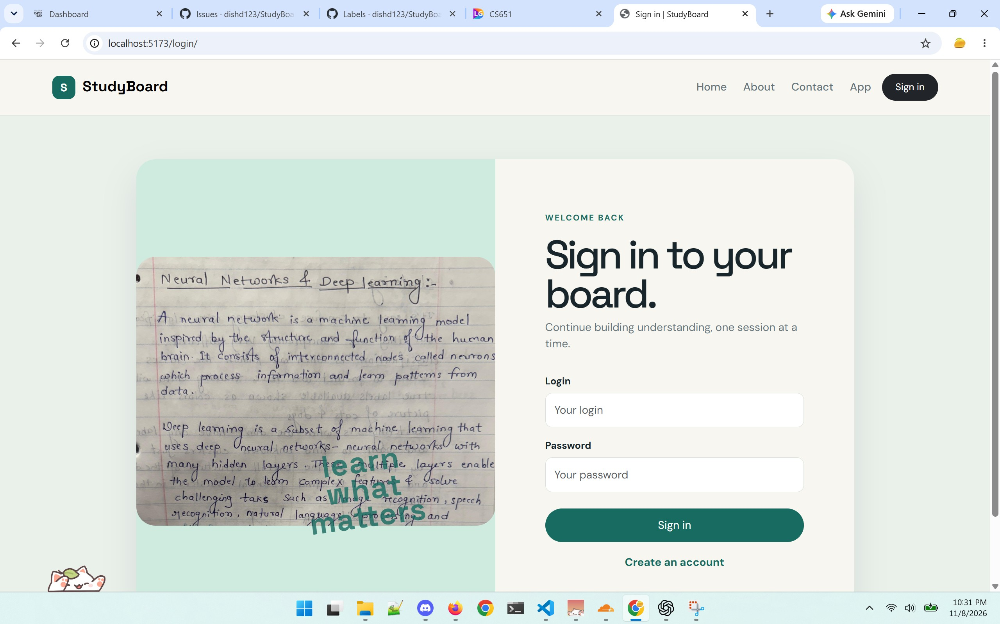
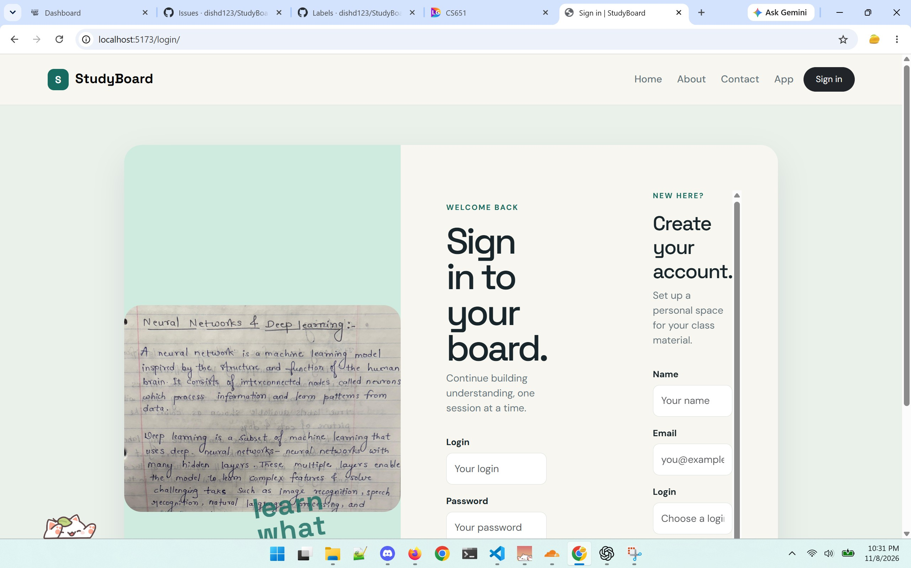

# StudyBoard — Project 1 frontend audit for Project 2

CS 651 Web Systems, Fall 2026 · Group 4

Issue owner: Huda Joad (`hjoad1`)

Recorded: November 8, 2026

Related issue: [#1 — Audit the existing Project 1 frontend](https://github.com/dishd123/StudyBoard/issues/1)

Baseline commit: `004be9c0741796e0a3c9b3e5e23c46a3c9aa2129`

## Purpose and evidence

This audit records the existing frontend before Project 2 implementation. It identifies pages, entry points, reusable components, sample behavior, missing features, navigation, and the current build/deployment structure. Project 2 scope follows the October 19 revised StudyBoard PDF; the October 13 DOCX is historical context.

Source findings were checked against the local repository at the baseline commit. Huda confirmed the five frontend URLs below work at `http://localhost:5173/` and supplied six screenshots in `docs/images/`. Codex inspected those screenshots and their visible page URLs. Interactive browser verification remains attributed to Huda; viewing screenshots is not an independent interactive browser test. This audit change adds documentation/evidence without altering application code or removing Project 1 functionality.

## Current architecture

The repository is a Vite multi-page site with two React entry points. Home, About, and Contact are traditional HTML pages. App and Sign In each mount a separate React root. There is no client-side router or backend API in the baseline.

```text
StudyBoard/
  index.html                 Home
  about.html                 About
  contact.html               Contact
  app/index.html             React App HTML shell
  login/index.html           React Sign In HTML shell
  src/
    SiteNav.jsx              Navigation for both React entry points
    app/main.jsx             Sample dashboard and study components
    login/main.jsx           Demonstration login/account forms
  css/site.css               Shared appearance and responsive rules
  js/site.js                 Static-page navigation, footer, contact handler
  public/images/             Five existing page/demo images
  vite.config.js             React build entries and static-page copy plugin
  package.json               Frontend dependencies and commands
  package-lock.json          Resolved dependency versions
  DockerContainer/           Project 1 Apache/Docker deployment
  docs/Special-Issues.pdf     Existing Project 1 documentation
```

## Page and file inventory

Line references describe the baseline and may change during later refactoring.

| File | Existing responsibility and source evidence | Project 2 treatment |
| --- | --- | --- |
| `index.html` | Home page; App launch link at line 21; static navigation/footer hooks at lines 12 and 38; Bootstrap and shared script at lines 39–40. | Retain marketing page and App launch workflow; update deployed destination when available. |
| `about.html` | About content, image, static navigation/footer, and shared script at lines 2–5. | Retain page and its purpose. |
| `contact.html` | Contact form, image, email link, and shared script at lines 2–5. | Retain page; distinguish demonstration form feedback from real delivery. |
| `app/index.html` | Mounts `#root` and loads `/src/app/main.jsx` at line 2. | Retain App entry point while extending the workspace. |
| `login/index.html` | Mounts `#root` and loads `/src/login/main.jsx` at line 2. | Retain Sign In entry point; later connect Google sign-in. |
| `src/app/main.jsx` | Contains sample sessions, `SessionCard`, `BoardPreview`, `FlashcardDeck`, `TutorPanel`, `Dashboard`, and root rendering at lines 6–45. | Extract and adapt existing React components instead of starting another app. |
| `src/login/main.jsx` | Local `LoginForm`, `CreateAccountForm`, `LoginApp`, and root rendering at lines 6–41. | Reuse page layout; replace mock forms with the revised Google-only sign-in under the authentication issues. |
| `src/SiteNav.jsx` | Shared React menu; page links at lines 1–6 and Sign In link at line 36. | Retain menu; later display authenticated user and Sign out. |
| `js/site.js` | Injects static navigation/footer at lines 1–13; contact submit handler at lines 15–16. | Preserve static-page behavior and keep its links consistent with React navigation. |
| `css/site.css` | Shared fonts, colors, page styles, workspace/card/tutor styles, login styles, and media queries at lines 1–10. | Reuse visual design; check responsive behavior after refactoring. |
| `public/images/` | `home-hero.jpg`, `about.jpg`, `contact.jpg`, `signin.jpg`, `app-board.jpg`. | Retain site images; identify the board image as demonstration material until real imports exist. |
| `vite.config.js` | Builds App/Login HTML entries at lines 18–24; copies Home/About/Contact, CSS, and JS into `dist` at lines 6–16. | Preserve all outputs during the move to `frontend/`. |
| `package.json` | `dev`, `build`, `preview`, and `check` commands at lines 6–10; React/Vite dependencies at lines 12–16. | Retain working commands and add testing separately. `check` currently performs a build, not unit tests. |
| `package-lock.json` | Records resolved frontend dependency versions. | Retain lockfile for reproducible installs; review it when package layout changes. |
| `.gitignore` | Ignores `.venv`, `node_modules/`, `dist/`, and `.DS_Store` at lines 1–4. | Expand for Project 2 local configuration and temporary files under issue #18. |
| `.dockerignore` | Excludes local dependencies/build output, Git metadata, virtual environment, and logs from Docker context. | Preserve as Project 1 deployment configuration; do not treat it as Cloud Run source-deployment configuration. |
| `DockerContainer/Dockerfile` | Node frontend build at lines 1–7; Apache serves built output at lines 9–12. | Record as existing Project 1 deployment, separate from proposed Project 2 hosting. |
| `DockerContainer/httpd.conf` | Static document root at lines 14–20; App/Login slash redirects at lines 22–26; log directives at lines 27–28. | Retain historical deployment behavior; no Express/API service is present here. |
| `DockerContainer/README.md` | Project 1 build/deployment instructions; known Apache log-format limitation at lines 108–112. | Keep historical instructions distinct from future Cloud Run instructions. |
| `README.md` | Project 1 AWS deployment description and addresses at lines 1–14; file map and run instructions at lines 20–41. | Update later to explain Project 2 layout without presenting old deployment claims as current verification. |
| `docs/Special-Issues.pdf` | Existing Project 1 artifact linked from `README.md:11`. | Preserve; its contents are outside this frontend source audit. |

## Reusable components and actual behavior

| Component | Existing behavior | Limits and next adaptation |
| --- | --- | --- |
| `SessionCard` (`src/app/main.jsx:12`) | Button selects one sample session and displays its title/date/counts. | Sample fields include multiple-board counts; revised sessions need one photo, free-text course, stored status, thumbnail, and card count. |
| `BoardPreview` (`src/app/main.jsx:16`) | Displays selected title and the same bundled board image. | Capture time and region count are hardcoded; no image import or recognized steps exist. |
| `FlashcardDeck` (`src/app/main.jsx:24`) | Uses React state for flipping and Previous/Next navigation across two sample cards. | Cards are not session-specific or persistent; add source-step, known state, deletion, filter, and empty state later. |
| `TutorPanel` (`src/app/main.jsx:32`) | Accepts typed input and displays a templated acknowledgement. | No agent/model call. The voice button only fills text; remove it for the revised typed-only tutor. |
| `Dashboard` (`src/app/main.jsx:38`) | Selects a sample session and displays the board/deck/tutor layout. | Greeting and session total are hardcoded; New and View all buttons are disabled. No course filter or Material/Notes/Study tabs. |
| `SiteNav` (`src/SiteNav.jsx:8`) | Shared React navigation with active-link styling and Bootstrap collapse markup. | No authenticated user, Sign out, or protected workspace. |
| Login/account layout (`src/login/main.jsx:17`) | Displays Sign In and optionally Create Account forms beside an image. | Reuse layout; revised scope removes Create Account and password forms. |

### Mock behavior that must not be counted as completed integration

- Sessions and cards are hardcoded inside `src/app/main.jsx:6–10` and `:27`.
- Switching sessions changes the selected title but does not load a corresponding board image, card deck, or tutor context.
- The tutor acknowledgement in `src/app/main.jsx:35` is a local string, not an answer grounded in notes.
- Login submission in `src/login/main.jsx:8` only displays a welcome message. Account creation at line 14 copies values into local React state; neither creates an account nor verifies credentials.
- Contact submission in `js/site.js:16` displays a success message and resets the form. It sends no network request, despite the wording that the message reached the team.
- The App is directly accessible without authentication. Current in-memory interactions are not saved to a database.

## Navigation and browser-check record

Static pages receive links from `js/site.js:5`; React pages use `src/SiteNav.jsx:1–6,36`. Both use ordinary page links for `/`, `/about.html`, `/contact.html`, `/app/`, and `/login/`. Home also links directly to `/app/` at `index.html:21`. These are frontend page routes, not implemented backend API endpoints.

Huda reported that the following URLs work from a frontend standpoint and provided the linked screenshots. The supplied list contains `/login/` twice; it is one route, with separate Sign In and Create Account states captured. The screenshots display November 8, 2026 on the desktop clock. They show Chrome on a Windows desktop; exact browser/OS versions and browser viewport dimensions were not supplied.

| Tested URL | Page/state | Result and visible evidence | Screenshot |
| --- | --- | --- | --- |
| `http://localhost:5173/` | Home | Pass — Huda reported the route works; screenshot shows navigation, hero text/image, and App launch link. | [Home](images/audit-home.jpg) |
| `http://localhost:5173/about.html` | About | Pass — Huda reported the route works; screenshot shows About content and active navigation. | [About](images/audit-about.jpg) |
| `http://localhost:5173/contact.html` | Contact | Pass — Huda reported the route works; screenshot shows contact fields, page content, and active navigation. | [Contact](images/audit-contact.jpg) |
| `http://localhost:5173/app/` | App | Pass — Huda reported the route works; screenshot shows sample sessions, greeting, and board preview. | [App](images/audit-app.jpg) |
| `http://localhost:5173/login/` | Sign In | Pass — Huda reported the route works; screenshot shows the existing mock sign-in form and Create Account control. | [Sign In](images/audit-sign-in.jpg) |
| `http://localhost:5173/login/` | Create Account state | Screenshot shows the account panel open beside Sign In on the same route; no real account creation is established. | [Create Account](images/audit-create-account.jpg) |

Visual observation: the Create Account screenshot shows narrow columns, heavily wrapped headings, and an internal scrollbar. Record this as an existing layout limitation rather than a fully successful layout check. The revised proposal removes that account-creation panel under issue #27; the current audit does not implement the replacement.

These screenshots support route rendering and the visible interface state, not every interaction. They do not establish contact delivery, real authentication/account creation, card/tutor interactions outside the captured area, backend APIs, or persistence. Cross-browser, mobile, accessibility, production-build, and live-cloud verification remain separate. Exact browser version, viewport, and individual control-by-control results are optional additional details; they are not required to complete issue #1's stated route/screenshot evidence.

### Screenshot gallery

#### Home



#### About



#### Contact



#### App



#### Sign In



#### Create Account state



## Build and deployment baseline

The package currently provides `npm run dev`, `npm run build`, `npm run preview`, and `npm run check`. There is no test or lint script. React, React DOM, Vite, and the React Vite plugin are the declared direct dependencies (`package.json:6–18`). No Firebase, Express, Gemini, Vision, or ADK dependency is declared.

Vite builds the App and Login entries, then copies the traditional static pages and supporting files into `dist`. Images are supplied from `public/images/`. Bootstrap CSS/JS are loaded from jsDelivr by the HTML pages, and fonts are imported from Google Fonts (`css/site.css:1`); browser styling and mobile menu behavior depend on those external resources being available.

The existing Docker configuration builds the frontend and serves `dist` through Apache on port 80. The README describes deployment on AWS EC2 using ECR and lists the historical site/IP. Those are repository documentation claims, not a live AWS deployment check performed for this audit. The Docker README also records a known access-log format limitation; it is not evidence of Google Cloud Logging implementation.

The revised Project 2 target is a `frontend/` and `backend/` split, Express serving `frontend/dist` and `/api` from one Cloud Run origin, root build/start scripts, and source deployment without a new Dockerfile. That target is not implemented at this baseline. Neither a production build nor Docker/Cloud Run deployment was executed as part of this documentation task; Huda's frontend check does not establish either result.

## Missing Project 2 implementation

| Area | Gap at baseline | Related issues |
| --- | --- | --- |
| Frontend organization | No extracted workspace pages/components, models, or fixture modules. | #2, #3 |
| Request/status handling | No central `apiClient`, token boundary, reusable `StatusMessage`, or systematic retries. | #4, #5 |
| Dashboard | No usable New/Rename/Delete, course filter, stored status, or empty-state workflow. | #6, #36 |
| Material | No one-photo import workflow, runtime recorder, extracted steps/transcript, or build action. | #7, #37–45, #54 |
| Notes | No aligned step/explanation table, summary, correction shading, or replace/re-record/rebuild workflow. | #8, #55 |
| Study | Demo cards/tutor are not backed by generated data; no source steps, saved review state, card deletion/filter, or tutor history. | #9, #56, #57 |
| Authentication | No Firebase setup, `useAuth`, Google sign-in, sign-out, verified user, or API authorization. | #24–30 |
| Backend/data | No Express service, route files, Firestore access, or persistence. | #13–21, #31–35 |
| Processing/agents | No direct Gemini photo/audio calls, Vision hint, `notesAgent`, `cardsAgent`, pipeline, `getSessionNotes`, or `tutorAgent`. | #23, #39–53 |
| Observability | No GA4 instrumentation or structured frontend/backend logging. | #58–62 |
| Documentation/tests | No UI-state plan or frontend unit-test setup. | #11, #12 |

## Revised-scope guardrails and ownership

Huda owns the initial frontend preparation, Firebase Authentication, Firestore, tutor/tool, analytics, and logging. Disha owns Photos authorization/Picker and direct Gemini photo processing with the Vision hint. Venkatesh owns runtime recording, direct Gemini audio processing, `notesAgent`, `cardsAgent`, and pipeline integration. Later integration issues transfer the relevant Phase 0 component to its named integration owner; this does not change Huda's ownership of the initial shell.

Keep one photo and one runtime recording per session, a free-text course field, numbered source steps, and typed tutor questions. Photo results include a thumbnail in Firestore; raw audio is discarded. Do not add standalone Board Reader/Explanation ADK agents, Cloud Storage media archives, courses/runs collections, bounding-box/timestamp navigation, spoken tutor questions, or note-version editing. Rebuild overwrites generated results and resets card-known marks.

Phase 0 can use labelled fixtures and local interactions. Passing this baseline audit does not establish that any cloud integration or subsequent frontend issue is complete.

## Issue #1 acceptance mapping and handoff

| Acceptance criterion | Audit evidence |
| --- | --- |
| Existing pages and entry points are documented. | Architecture, file inventory, and navigation sections. |
| Existing reusable code is identified. | Component table and source references. |
| Mock behavior is separated from future backend behavior. | Mock behavior and missing implementation sections. |
| Navigation and deployment structure are documented. | Navigation/browser record and build/deployment baseline. |
| No Project 1 functionality is removed. | Audit documentation and screenshots do not change application source. |
| File-by-file audit and browser/manual evidence are supplied. | File inventory, exact local URLs, Huda-reported checks, and six inspected screenshots linked and embedded above. |

Issue #1's audit and evidence requirements are covered by this document and the supplied screenshots. No additional manual evidence is required for its stated acceptance criteria. It is ready for review and publication through the repository's PR workflow; the issue has not been closed by this local change. Exact browser/OS versions, viewport, and detailed interaction notes can be added if desired. The separate five issue-board screenshots remain tracked under issue #88.

Next, settle the layout under #2, relocate the frontend under #15 before substantial component development, then proceed with models/fixtures (#3), API client (#4), status UI (#5), and the dashboard/tabs (#6–9). Preserve navigation under #10, document states under #11, and add the separate frontend-test PR under #12. Issue #1 should be closed through the agreed review/merge workflow after this document is reviewed.

## AI assistance disclosure

OpenAI Codex assisted with repository source inspection, drafting this audit, and visual inspection of Huda's six screenshots. Browser route results were supplied by Huda. Codex did not perform those interactive browser checks, run a production build, or deploy the application for this documentation change.
