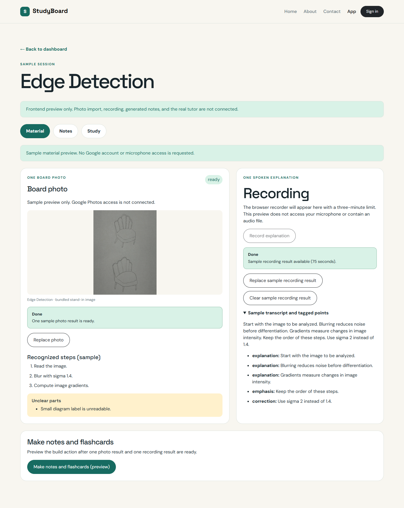
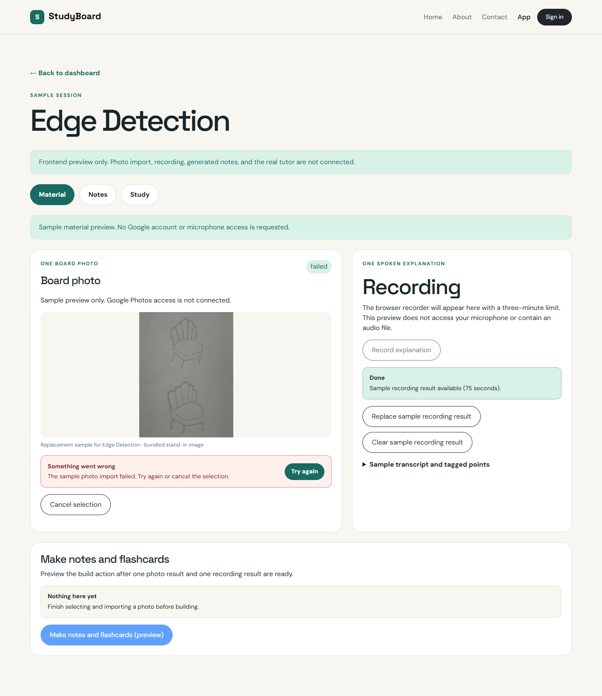

# Material tab shell — issue #7

Owner: Huda Joad. Related issue: [#7](https://github.com/dishd123/StudyBoard/issues/7).
Scope: one photo and one recording result with explicit sample callbacks.

## Files and ownership

| File | Responsibility |
| --- | --- |
| `src/components/MaterialTab.jsx` | Photo selection/import states, sample recording callbacks, build prerequisites, mock loading/failure/retry/completion, and timer cleanup. |
| `src/components/PhotoImportPanel.jsx` | Controlled one-photo preview, actions, recognized sample steps, unreadable flags, and StatusMessage feedback. |
| `src/components/RecordingPlaceholder.jsx` | Labelled future recorder slot plus optional synthetic transcript/point results for preview. |
| `src/fixtures/materialPreview.js` | Independent synthetic photo/audio results copied from the selected session or a ready fallback fixture. |
| `src/pages/SessionWorkspace.jsx` | Passes material callbacks from App into the Material tab. |
| `src/app/App.jsx` | Applies committed input changes to the correct local session and invalidates derived results. |
| `css/site.css` | Responsive photo, action, transcript, flag, and build presentation. |

All initial shell work belongs to Huda. Disha will connect the Photos OAuth,
Picker, image processing, and real photo import. Venkatesh will add runtime
recording/audio processing and the actual build pipeline. This issue calls none
of those services and requests neither microphone permission nor Google access.
No Firebase, raw media files, upload input, polling, or API dependency is added.

## Photo states

| State | Behavior |
| --- | --- |
| Empty | No saved photo; Select sample photo stages one synthetic result. |
| Selected | Shows one pending thumbnail; Use sample photo begins the mock import, Cancel discards the selection. Build is unavailable while selection is pending. |
| Processing | Shows loading for 800 ms; conflicting actions are disabled. Cancel import clears the timer and returns to the prior saved state. |
| Failed | Shows a plain error and Try again; selection remains available. A failed replacement does not overwrite the previous photo or discard its study results. |
| Ready | Shows one accepted photo result, ordered sample steps, and explicit unreadable parts. Replace photo stages its replacement. |

PhotoImportPanel is controlled through `photo`, `selection`, `status`, `error`,
`disabled`, `onSelect`, `onImport`, and `onCancel`. Its image is a bundled
stand-in; the synthetic text does not claim to have been extracted from it.
There is no multi-photo list or archive. Pending and saved photo are distinct:
selection/cancellation is local UI state, and only a successful acceptance
replaces `session.photo`.

## Recording placeholder

The actual Record explanation button is disabled and labelled as a future
three-minute browser recorder. Use sample recording result supplies synthetic
processed text; it does not play, upload, or pretend to capture audio. Existing
results display length, transcript, and points tagged explanation, correction,
or emphasis. Replace/Clear sample result exercise the singular audio slot.

## Parent callbacks and stale output

The current callbacks are synchronous local-preview operations:

- `onPhotoChange(photo)` commits one processed photo result.
- `onAudioChange(audioOrNull)` replaces or clears one recording result.
- `onMockRebuild()` checks that the target session has both saved inputs; it
  generates no notes or cards and changes no stored processing status.

App binds callbacks to the session ID. A committed material change clears its
summary, notes, cards, card count, and error, returns the session to draft, and
updates its timestamp. It also clears a stale processing snapshot for that
session. Other sessions remain unchanged; missing/deleted session callbacks are
ignored. Existing question history remains historical data rather than new
answers, and this issue adds no history UI.

The mock rebuild is disabled until a photo has finished acceptance and an audio
result exists. Missing-input messages explain what is needed. Busy operations
disable conflicting controls. Mock rebuild failure exposes Try again; retries
show disabled pending controls through StatusMessage. Success explicitly says
that no notes/cards were generated or saved. A draft is not marked ready merely
because the UI simulation finished. Real pipeline validation/persistence stays
in #46–54.

Committed inputs survive tab changes and returning to the dashboard because App
owns them. Pending selection, operation feedback, and timers live in MaterialTab;
switching tabs/leaving the workspace discards pending work. Cleanup cancels the
timer so a later callback cannot overwrite another session. Refresh restores
the selected fixture and discards all preview edits.

## Manual review

Start `npm run dev` and open `/app/?fixture=draft`. Open the session's Material
tab, then:

1. Verify the empty photo/recording feedback and disabled build action.
2. Use a sample recording result; build must remain disabled without a photo.
3. Select a sample photo; cancel once, then select and use it.
4. Observe processing followed by the one-photo result and recognized steps.
5. Clear the recording; build must become unavailable again. Add it back.
6. Run Make notes and flashcards (preview); observe loading and explicit mock
   completion. This does not populate the Notes or Study tab.
7. Replace the photo; cancel to retain existing material or accept to invalidate
   old generated results. Revisit the dashboard to see the draft/card-count state.

Development-only failure previews:

```text
http://localhost:5173/app/?fixture=draft&photoFailOnce=1&buildFailOnce=1
```

The first photo import and first mock build fail once per MaterialTab mount;
Try again then succeeds. These flags are ignored in production builds and
are not API settings. The timer is a local simulation, not Picker polling.
Switching away and remounting starts a fresh failure-preview attempt.

## Preview evidence

Captured from the actual local preview on November 9, 2026 using headless Chrome.
These screenshots show sample frontend states, not live integrations.

### Ready material and recording-result placeholder



### Failed photo replacement with retry



## Acceptance mapping

| Issue #7 requirement | Evidence |
| --- | --- |
| Empty/selected/processing/failed/ready photo | Controlled PhotoImportPanel plus mock selection/import and development failure preview. |
| Clear recording placeholder | Disabled actual recorder; explicitly labelled synthetic result controls. |
| Mock rebuild | Prerequisite checks, loading, failure/retry, and explicit non-generating completion. |
| Replace photo | Separate pending result; cancel/failure preserve saved input, successful acceptance replaces it. |
| One photo | Singular saved field and at most one visible preview image. |
| Missing-input checks | Missing photo or recording disables build and displays an explanatory message. |

## Verification results

Codex ran the following checks on November 9, 2026 with Linux Node `v22.23.2`
and headless Chrome through Playwright. The temporary dev server used port
`4175`, without taking over Huda's normal server. No dependency/lockfile changes
were needed.

| Check | Result |
| --- | --- |
| Production build | Passed for App/Login and the static pages. |
| Photo states | Empty/selected/processing/failed/ready rendered through the fixture-driven workflow. |
| Photo replacement | At most one preview image; accepted replacement updates steps and clears stale cards. |
| Cancellation/failure | Cancelled selection and failed/cancelled replacement preserve the previous session deck. Cancel import prevents a later commit. |
| Missing photo/audio | Build stays disabled with an explanatory message for each missing-input case and while photo selection is pending. |
| Recording slot | Actual Record disabled; sample transcript, length, and point tags render; clearing its result invalidates derived output. |
| Mock build | Loading disables conflicting actions; injected failure shows retry; retry has a disabled pending state and ends with an explicit non-generating completion. |
| Committed inputs/navigation | Accepted material survives tab changes; pending timers are cancelled on unmount and do not modify a newly selected session. |
| Session isolation | Replacement clears only the selected session's cards; another session's deck is unaffected. |
| Processing snapshot | Committed material changes clear the old processing badge/status line rather than inheriting a stale run. |
| Fixture integrity | Node assertions passed for independent clones, unchanged source fixtures, missing-input fallbacks, and replacement with no recognized steps. |
| Keyboard/mobile | Space selection and Enter retry passed; no horizontal overflow observed at 390 × 844. |
| Existing pages | Home/About/Contact/Login rendered; dashboard session creation still works. |
| External side effects | No backend requests or Google popups observed; recorder permission was not requested. No browser runtime errors observed. |
| Evidence/formatting | Two actual Material screenshots captured; whitespace checks passed. |

These were one-off implementation checks. Dedicated persisted frontend tests
remain under issue #12; full browser/assistive-technology testing remains later
QA work. Real Photos, runtime audio, Gemini, and ADK remain separate integration
issues. Issue #7 is ready for review in its own PR with `Closes #7`.
