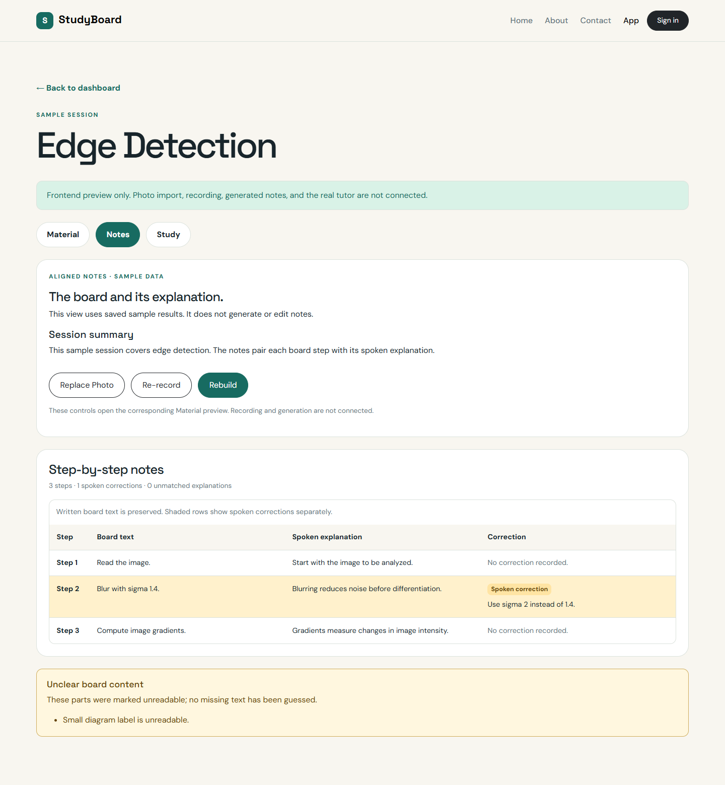
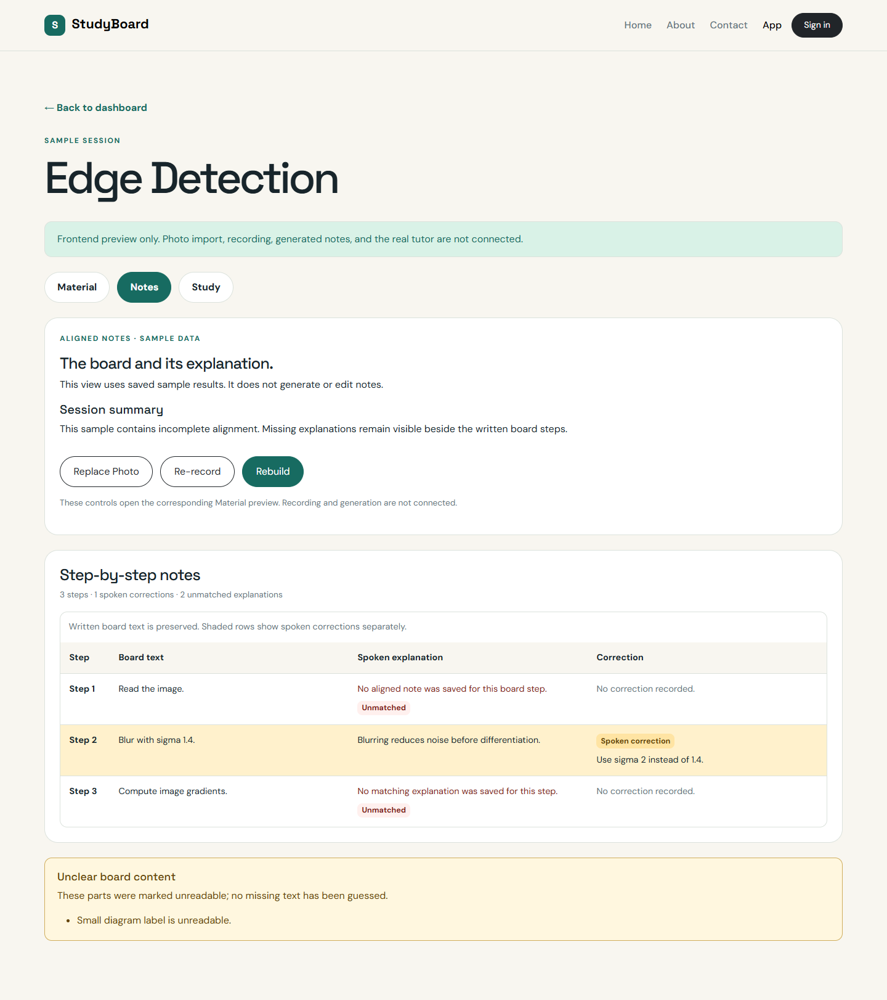

# Notes tab shell — issue #8

Owner: Huda Joad. Related issue: [#8](https://github.com/dishd123/StudyBoard/issues/8).
Scope: read-only presentation of saved sample results from the revised proposal.

## Files and ownership

| File | Responsibility |
| --- | --- |
| `src/components/NotesTab.jsx` | Summary, notes state feedback, unreadable flags, and Material action buttons. |
| `src/components/AlignedNotesPanel.jsx` | Numbered step table, source text, saved explanations, correction shading, and unmatched indicators. |
| `src/fixtures/notesPreview.js` | Independent development-only aligned/unmatched/conflict snapshots. |
| `src/app/App.jsx` | Applies a Notes preview once when initializing fixture state and passes the selected session's operation state. |
| `src/pages/SessionWorkspace.jsx` | Supplies saved session data and routes Notes actions into Material. |
| `src/components/MaterialTab.jsx` | Focuses/scrolls to the requested photo, recording-result, or build area. |
| `src/components/PhotoImportPanel.jsx`, `RecordingPlaceholder.jsx` | Mark the corresponding focus targets without starting any request. |
| `css/site.css` | Notes table, correction/flag styles, horizontal table scrolling, and keyboard focus. |

Huda owns the initial shell. Venkatesh's saved-note/backend integration remains
issue #55. No Gemini/ADK call, Firestore connection, note editor, version history,
bounding-box overlay, or timestamp-linked audio player is added.

## Rendering rules

NotesTab receives the current `session`, its temporary `operation`, and an
`onEditMaterial(target)` callback. The summary is `session.summary`; no new
summary is generated. The table contains one row per saved `session.photo.steps`
entry, in source order. Saved notes are matched by their numbered `step`.

The Board text column preserves `photo.steps[].text`. Spoken explanation and
correction come from the matching saved note. The UI does not infer a match by
comparing transcript text, rewrite the written value, or fill gaps using outside
knowledge. In the correction example, the board keeps `sigma 1.4` while the
separate correction says `sigma 2`.

| Row state | Display |
| --- | --- |
| Aligned | Saved explanation, with no correction recorded. |
| Corrected | Saved explanation plus an explicit Spoken correction label/text; row is shaded. |
| Unmatched | A saved alignment exists for the session, but this step has no note or no explanation. The gap is labelled Unmatched and explained plainly. |
| Not generated | No aligned notes have been saved yet; source steps can still be shown without implying failed matching. |
| Pending | A processing snapshot is active; rows wait for generated notes instead of prematurely claiming unmatched input. |

Corrections remain visible even if an explanation is missing. The panel counts
steps, saved corrections, and unmatched explanations. Photo unreadable parts
appear in a separate labelled notice; the UI does not guess their text. Missing
photo/summary/notes, pending processing, and failed builds use explicit feedback.
The existing #5 StatusMessage component supplies loading/error/empty semantics.

The unmatched preview demonstrates both an absent note and a note with
`explanation: null`. It does not attempt to identify unmatched speech points:
the revised model has no per-point alignment ID with which to make that claim.

## Material actions

- Replace Photo opens Material and focuses its sample photo selector/replacement
  control. It does not immediately replace data.
- Re-record opens Material and focuses its recording-result preview control.
  Actual microphone recording remains unavailable until the recording issue.
- Rebuild opens Material and focuses the build section, including any missing
  prerequisite message. The user can then run the existing mock rebuild.

These are navigation/focus callbacks, not direct service requests. Normal tab
navigation clears the focus request. The build section can receive programmatic
focus even when its action button is disabled because inputs are missing.

The issue #7 rules still apply: committing a photo/audio change clears old
summary, notes, and cards and returns the session to draft. Notes then displays
the new board steps with no generated explanation/correction. The mock rebuild
does not repopulate notes or reapply a fixture override. Existing fixture notes
remain intact when a mock rebuild runs without changing input material.

## Development fixtures and manual review

Run `npm run dev`, open a session, and select Notes:

```text
http://localhost:5173/app/?fixture=ready
http://localhost:5173/app/?fixture=ready&notesPreview=unmatched
http://localhost:5173/app/?fixture=ready&notesPreview=conflict
http://localhost:5173/app/?fixture=draft
http://localhost:5173/app/?fixture=processing
http://localhost:5173/app/?fixture=failed
```

`notesPreview` is development-only, applied once at workspace initialization.
It modifies a cloned ready sample, never the source fixture. Unfinished/empty
sessions do not gain invented notes. Unsupported preview modes fall back to
the unchanged aligned data. Production builds use the normal ready fixture
without query overrides until the later API integration replaces fixture data.

In the default/conflict view, verify the separate written/corrected sigma values
and shaded row. In unmatched, check the two different missing-explanation cases.
Try all three Material actions, then commit a sample photo or recording change
and return to Notes to confirm stale content is gone. Refresh restores fixtures.

## Accessibility and responsive behavior

The table uses a caption, column headers with `scope="col"`, and numbered row
headers with `scope="row"`. Labels communicate correction/unmatched states in
addition to color. At narrow widths the table scrolls inside a named, keyboard-
focusable region rather than overflowing the document. Native action buttons
have visible focus; action navigation focuses the intended Material area.
This markup/browser check does not replace later screen-reader testing.

## Screenshot evidence

Captured from the actual local preview on November 9, 2026 using headless Chrome
at a 1440 × 1000 viewport with full-page capture. These are sample frontend
states, not evidence of live AI processing.

### Aligned notes with a spoken correction



### Incomplete alignment



## Acceptance and verification

| Issue #8 criterion | Evidence |
| --- | --- |
| Numbered steps | One source-numbered table row per photo step. |
| Board/explanation/correction | Separate columns; original written values are preserved. |
| Unclear or unmatched content | Unreadable-part notice, missing-note and null-explanation states. |
| Replace/Re-record/Rebuild controls | Material navigation and focus callbacks, with no automatic media/model call. |
| No boxes/timestamp linking | Read-only text/step interface with no new source-coordinate model. |

Codex verified the implementation on November 9, 2026 using Linux Node
`v22.23.2` and headless Chrome through Playwright. A temporary Vite server used
port `4175`; no dependencies/lockfiles were changed.

| Check | Result |
| --- | --- |
| Production build | Passed for App/Login and static pages. |
| Fixture assertions | Aligned/unmatched/conflict sources, independent clones, valid step references, unfinished-session guards, and unknown-mode fallback passed. |
| Saved output | Summary, three numbered rows, explanations, unreadable flag, and separate sigma correction passed. |
| Semantic table | Four column headers and three scoped row headers verified. |
| Correction state | Original value and replacement text both present; correction label and actual shaded background verified. |
| Unmatched state | Missing-note and explicit null-explanation cases both render as unmatched without filling gaps. |
| Unfinished sessions | Draft has no invented table; processing rows wait; failed build shows error and not-generated rows. |
| Material actions | Correct photo/recording/build target receives focus; keyboard Rebuild navigation passed. |
| Stale results | Photo/recording changes clear old notes; mock rebuild does not regenerate or resurrect fixture output. |
| Session isolation | Another course's saved table remains intact with no leaked corrections. |
| Mobile/keyboard | At 390 × 844 the document does not overflow; focused table region scrolls horizontally with ArrowRight. |
| Existing pages/runtime | Home/About/Contact/Login render; no Google popup, backend API request, or browser runtime error observed. |
| Evidence/formatting | Two screenshots captured; whitespace checks passed. |

These were one-off implementation checks. Dedicated persisted frontend tests
remain under issue #12; full cross-browser/assistive-technology QA is later work.
Issue #8 is ready for its own reviewed PR with `Closes #8`.
