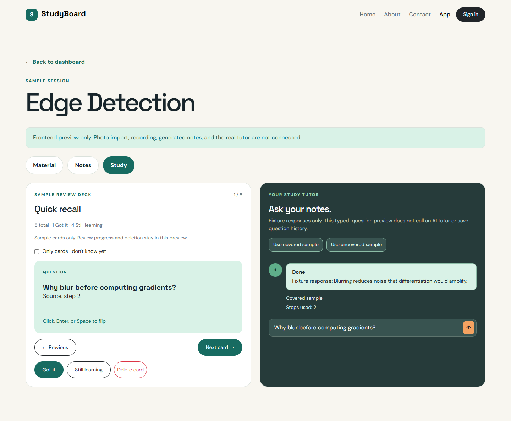
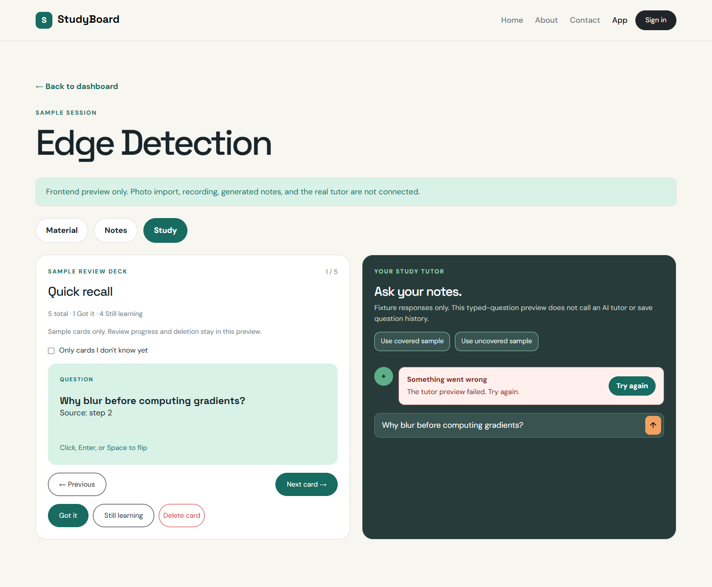

# Study tab — issue #9

Owner: Huda Joad. Related issue: [#9](https://github.com/dishd123/StudyBoard/issues/9).
Scope: local flashcard review and explicitly labelled typed tutor fixtures.

## Files and ownership

| File | Responsibility |
| --- | --- |
| `src/components/StudyTab.jsx` | Composes flashcards and typed tutor side by side on desktop. |
| `src/components/FlashcardDeck.jsx` | Flip/navigation, known-state controls, unknown-only filter, delete confirmation, counts, feedback, and focus recovery. |
| `src/components/TutorPanel.jsx` | Typed input, sample prompts, validation, loading, fixture response/source display, failure/retry, and timer cleanup. |
| `src/fixtures/tutorPreview.js` | Exact saved-fixture response lookup with source-step validation and an explicit no-match result. |
| `src/app/App.jsx` | Holds session-scoped cards/questions and applies local known/deletion changes, including aggregate card counts. |
| `src/pages/Dashboard.jsx`, `SessionWorkspace.jsx` | Pass the selected session, examples, and mutation callbacks to the same reusable Study view. |
| `css/site.css` | Review controls/filter, inline confirmation, tutor sample prompts/source labels, and responsive/focus styles. |

Huda owns this initial frontend issue. Venkatesh's real generated-card UI/API
integration remains #56. Huda's real tutor integration remains #57 with its
agent/tool/backend issues. This issue adds no Firebase, Firestore, model call,
analytics, raw media, or spoken tutor feature.

## Flashcard behavior

The deck uses stable card IDs for selection and flip state. Previous/Next wrap
through the visible deck and reset the new card to its question. Both controls
are disabled when only one card is visible. The card is a native button with
pressed state, supporting Enter and Space as well as clicks. Source step numbers
remain visible on both faces.

Got it sets `known: true`; Still learning sets `known: false`. Pressed-state
buttons identify the current progress. The unknown-only checkbox filters cards
without changing the total or deleting known cards. Marking the last visible
unknown card Got it exposes an all-known empty state and focuses the checkbox
so the user can clear the filter. Total/known/learning counts remain explicit.

Delete card opens an inline confirmation region showing the exact question;
it is not a modal dialog. Cancel receives focus. Cancel restores Delete card
focus without changing data. Confirm removes only that card and selects the
next/nearest visible card. If no visible card remains, focus returns to the
filter. Navigation, progress changes, or filter changes dismiss a pending
confirmation rather than deleting a different card.

App owns review data, so progress/deletions survive tab changes and moving
between the dashboard overview and session workspace. A deletion updates the
session's `cardCount` and timestamp; progress changes do not change total count.
Other sessions are unaffected. Refresh restores the original fixture (including
its one initially known card). No browser storage or database is used.

## Typed tutor preview

The tutor accepts typed questions only. The sample prompt buttons fill the input
without submitting it. The user still presses Send or Enter. Blank/whitespace
questions show an associated validation error. During the 800 ms sample request,
input/send/sample controls are disabled, and StatusMessage shows loading.

The lookup matches sample question text after whitespace/case normalization;
it does not perform retrieval, reasoning, or model inference. A matching fixture
shows `Fixture response`, a Covered/Uncovered sample label, and its saved step
numbers. Covered citations must reference currently available board/note steps.
Deleting a card alone does not invalidate the underlying notes or block tutoring.

An arbitrary question without a valid fixture match gets an explicit no-sample
message: the preview cannot determine whether the material covers it. It does
not invent an answer or incorrectly classify the real question as uncovered.
This transient `no-match` preview result has `covered: null`; it is **not** a
saved Question record. The saved question contract from #3 remains boolean.

Question history is not written or edited. Existing fixture questions supply
sample responses only. If material changes clear the session notes, the tutor
input and sample controls are disabled and explain that notes are required.

Failure exposes an optional retry for the same submitted question, with disabled
pending retry feedback. There are no automatic retries. Editing the question
clears old validation/response/error feedback. Leaving the view cancels the
timer; question input and response state reset on remount. This avoids a late
response appearing under another session.

## Preview and manual review

Run `npm run dev`, open a session from `/app/`, and select Study.

1. Flip with Space/Enter, then use Previous/Next.
2. Mark cards Got it/Still learning and toggle Only cards I don't know yet.
3. Cancel a deletion, then confirm one; verify the dashboard card count updates.
4. Switch tabs and return; review progress should remain until refresh.
5. Submit an empty tutor question, then choose/send the covered sample.
6. Try the uncovered sample and an arbitrary question with no sample answer.
7. Refresh and check that the original fixture is restored.

For the failure/retry preview:

```text
http://localhost:5173/app/?fixture=ready&tutorFailOnce=1
```

Open Study and send a sample question. The first valid attempt fails once per
TutorPanel mount; Try again succeeds. The development flag is ignored in
production builds. The ordinary production preview still uses explicitly
labelled fixture data until the real API integration replaces it.

At `/app/?fixture=draft`, Study has no cards and explains that notes must be
built before a tutor question. Committing a replacement photo/recording also
clears old cards and disables sample tutoring until notes exist again. The
mock rebuild from #7 does not generate replacement notes/cards.

## Screenshot evidence

Captured from the actual local preview on November 9, 2026 with headless Chrome
at 1440 × 1000 using full-page capture. These are sample frontend states, not
evidence of an AI call or persistent review progress.

### Ready Study view and covered sample response



### Tutor failure with retry



## Acceptance and verification

| Issue #9 requirement | Evidence |
| --- | --- |
| Flip/navigation | Existing behavior retained with stable IDs, visible source step, and native keyboard controls. |
| Known/delete/filter states | Local App mutations, unknown-only checkbox, empty/all-known states, and inline confirmation. |
| Typed questions | Labelled input, blank validation, Enter/Send, and no voice control. |
| Clearly labelled fixtures | Every result identifies itself as a fixture; no-match does not invent an answer or real coverage assessment. |
| Tutor states | Empty/idle, loading, success, validation failure, request failure, and retry. |

Codex verified the implementation on November 9, 2026 using Linux Node
`v22.23.2` and headless Chrome through Playwright. A temporary Vite server used
port `4175`; dependencies/lockfiles were unchanged.

| Check | Result |
| --- | --- |
| Production build | Passed for App/Login and static pages. |
| Fixture lookup | Exact match, whitespace/case normalization, source validation, independent citation arrays, and no-match behavior passed Node assertions. |
| Card keyboard/navigation | Enter/Space flip, Previous/Next, source step, and position counts passed. |
| Review/filter | Got it/Still learning, unknown-only, all-known empty state, one-card disabled navigation, and checkbox focus recovery passed. |
| Card deletion | Cancel/confirm, focus restoration, final-card empty state, and no invalid card-index access passed. |
| State scope/counts | Progress survives tabs and dashboard/workspace navigation; session count updates and other sessions remain unchanged. |
| Refresh | Restores five cards and the fixture's original known state. |
| Tutor validation/loading | Associated blank-input error, sample prompts, and disabled pending controls passed. |
| Tutor results | Covered/uncovered fixtures, source citations, and honest arbitrary-question no-match passed. |
| Failure/retry | Injected error, keyboard retry, disabled pending retry, and successful completion passed. |
| Cleanup/invalidation | Pending timer does not update another session; cleared notes disable tutoring even though historical fixture questions remain. |
| Mobile/existing pages | No horizontal overflow at 390 × 844 for response/confirmation; Home/About/Contact/Login rendered. |
| Side effects/runtime | No backend API request, Google popup, or browser runtime error observed. |
| Evidence/formatting | Two screenshots captured; whitespace checks passed. |

These were one-off implementation checks. Dedicated persisted frontend tests
remain under #12, with full cross-browser/assistive-technology QA later. Issue
#9 is ready for its own reviewed PR with `Closes #9`.
